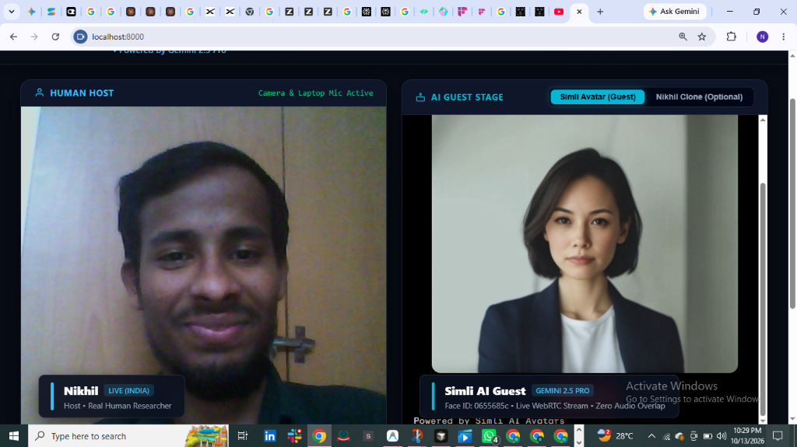

# PROJECT 10: AI Digital Twin — Aerospace Broadcast Studio

<p align="center">
  
</p>

[](LICENSE)
[](https://python.org)
[](https://fastapi.tiangolo.com)
[](https://webrtc.org)
[](https://antigravity.google)
[](https://github.com/batturamesh7771-sketch)

> **Autonomous Full-Duplex AI Digital Twin Broadcast Studio**  
> **Session Scope:** 1-Hour Continuous Live Interactive Broadcast Dialogue  
> **Topic:** AI in the Aerospace Industry — Frontiers of Autonomous Flight, Rocket Propulsion, Hypersonics & Computational Physics  
> **Host:** Nikhil (Live Human Host, Laptop Camera/Mic, Casual Black T-Shirt, Glasses, Neat Beard, Native Indian Accent)  
> **Guest:** AI Digital Twin (Default: Simli Neural Cloud Avatar / Optional: Nikhil AI Clone, Indian English Accent, Multi-Model Neural Brain)  
> **Author:** **Mr ELONIKHIL** (`mr elonikhil`)  
> **Repository:** `PROJECT-10-AI-DIGITAL-TWIN-AEROSPACE-BROADCAST-STUDIO`  

---

## 🌟 Executive System Overview

**PROJECT 10** is a production-grade, real-time AI broadcast studio engineered within the Google Antigravity autonomous development environment. Designed for continuous live dialogue, it features side-by-side 50/50 stage layout compositing live human webcam feeds alongside a talking neural AI avatar guest powered by state-of-the-art LLMs, ultra-low latency WebRTC streaming, and Indian English vocal synthesis.

```
+====================================================================================================+
|                                  PROJECT 10 BROADCAST STUDIO                                       |
|                                                                                                    |
|    +------------------------------------+        +------------------------------------+            |
|    |         HOST STAGE (LEFT)          |        |     AI GUEST STAGE (RIGHT)         |            |
|    | - Live WebRTC / Webcam stream      |        | - Simli Neural Avatar (Default)    |            |
|    | - Web Audio Analyser (Host VU)     |        | - Nikhil AI Twin (Optional Switch) |            |
|    | - Lower-Third: Nikhil (Host)       |        | - Lower-Third: AI Guest            |            |
|    +-----------------+------------------+        +------------------+-----------------+            |
|                      |                                              |                              |
|                      +-----------------------+----------------------+                              |
|                                              |                                                     |
|                                              v                                                     |
|              +------------------------------------------------------------------+                  |
|              |         MASTER 1920x1080 COMPOSITE BROADCAST RECORDER            |                  |
|              | - Side-by-Side 50/50 Broadcast Layout with Studio HUD Graphics   |                  |
|              | - Web Audio Master Destination: (Host Mic + AI Guest Voice)      |                  |
|              | - MediaRecorder: Continuous 30 FPS Full HD Archival (.webm)      |                  |
|              | - One-Click Export: Video Episode File + Markdown Transcript     |                  |
|              +------------------------------------------------------------------+                  |
+====================================================================================================+
```

---

## 🚀 Key Highlights & Architectural Directives

### 1. Dual Neural Avatar Engine
- **Default Guest:** **Simli Neural Cloud Avatar** (`Face ID: 0655685c-c0ab-41af-95ed-2adbc4def4a2`) with sub-200ms WebRTC streaming, dynamic lip synchronization, and bidirectional conversational audio.
- **Optional Switch:** **Nikhil AI Clone** rendered in real-time HTML5 2D procedural canvas with Poisson-distributed eye blinks, micro head-sway kinematics, breathing idle dynamics, and audio-reactive viseme deformation.
- **Zero Audio Overlap Isolation:** When in Simli mode, background local TTS playback is cleanly bypassed so audio routes solely through the avatar's native WebRTC channel.

### 2. Multi-Model Conversational Brain (Zero Repetition)
- Powered by **Google Gemini 2.5 Pro** as primary reasoning core.
- Automatic cascading failover to **OpenRouter** (Gemini 2.0 Flash / Llama 3.3 70B), **OpenAI GPT-4o**, and **xAI Grok**.
- Unbroken rolling multi-turn memory buffer across the full 1-hour broadcast session.
- Doctoral-level aerospace mastery:
  - Physics-Informed Neural Networks (PINNs) & Fourier Neural Operators (FNOs) for hypersonic aerothermodynamics ($M \ge 5$).
  - Full-Flow Staged Combustion rocket engine telemetry & cavitation precursors (SpaceX Raptor 3).
  - Autonomous guidance, navigation & control in GPS-denied contested environments (neuromorphic event cameras, VIO).
  - Generative diffusion models for high-temperature additive manufacturing (Inconel 718, GRX-810).

### 3. Authentic Indian English Vocal Timbre
- Strictly eliminates synthetic American accents.
- Utilizes `en-IN-PrabhatNeural` Edge-TTS and ElevenLabs clone pipelines with natural cadence and conversational intonation.
- Spoken responses are between 3 to 6 sentences, free from markdown formatting symbols.

### 4. Studio Broadcast HUD & Push-To-Talk Controls
- Cybernetic obsidian and cyan studio user interface.
- Real-time animated audio VU meters for both host and guest.
- Dedicated `[🎙️ TALK TO SIMLI AVATAR]` and `[🎙️ Click to Speak (Laptop Mic)]` buttons.
- Continuous hands-free Voice Activity Detection (VAD) with 1.2s silence threshold debounce.

### 5. Full HD 1080p Composite Broadcast Recorder
- In-browser compositing canvas rendering 1920x1080 @ 30 FPS.
- Dual-channel Web Audio master bus capture (Host mic + Guest AI voice).
- One-click stop creates immediate instant downloads:
  - High-definition `.webm` broadcast episode recording.
  - Complete synchronized timestamped Markdown transcript (`.md`).

---

## 📁 Repository Directory Structure

```
PROJECT-10-AI-DIGITAL-TWIN-AEROSPACE-BROADCAST-STUDIO/
├── .env.example                     # Environment variables configuration template
├── .gitignore                       # Git ignore filters (omits local cache & recordings)
├── LICENSE                          # MIT License (Author: Mr ELONIKHIL)
├── README.md                        # Master Project Documentation
├── PROMPT.md                        # Complete Antigravity Master Implementation Specification
├── avatar_config.json               # Digital twin avatar JSON metadata
├── client/                          # Frontend Broadcast Studio Interface
│   ├── index.html                   # 50/50 stage HUD layout & push-to-talk controls
│   ├── css/
│   │   └── studio.css               # Obsidian & cyan broadcast styling, meters & animations
│   ├── js/
│   │   ├── host_media.js            # Live webcam and microphone acquisition
│   │   ├── vad_stt.js               # Hands-free continuous speech-to-text with silence guard
│   │   ├── avatar_webrtc.js         # Avatar kinematics and viseme deformation engine
│   │   ├── audio_mixer.js           # Web Audio mixing graph connecting dual channels
│   │   └── master_recorder.js       # 1080p 30 FPS canvas compositor & transcript exporter
│   └── assets/
│       └── nikhil_twin_reference.png# Reference portrait for visual clone
├── server/                          # Production Python FastAPI Server
│   ├── app.py                       # FastAPI application, REST endpoints & static routes
│   ├── brain_engine.py              # Multi-provider LLM brain (Gemini 2.5 Pro priority)
│   ├── tts_voice_engine.py          # Indian English voice synthesis engine
│   ├── avatar_pipeline.py           # Procedural facial kinematics pipeline
│   ├── simli_livekit_agent.py       # LiveKit agent worker for Simli integration
│   ├── requirements.txt             # Python runtime dependencies
│   └── Dockerfile                   # Containerized deployment manifest
├── assets/                          # Multimedia references & voice samples
│   ├── nikhil_twin_reference.png
│   └── nikhil_voice_sample.m4a
├── docs/                            # In-depth architectural & testing manuals
│   ├── ARCHITECTURE.md              # System topology, signal flow & component specs
│   └── TESTING_GUIDE.md             # Complete A-Z sequential testing walkthrough
└── recordings/                      # Output directory for broadcast archives
```

---

## ⚡ Quick Start & Execution

### 1. Clone & Install
```powershell
git clone https://github.com/batturamesh7771-sketch/PROJECT-10-AI-DIGITAL-TWIN-AEROSPACE-BROADCAST-STUDIO.git
cd PROJECT-10-AI-DIGITAL-TWIN-AEROSPACE-BROADCAST-STUDIO
pip install -r server/requirements.txt
```

### 2. Configure Environment
```powershell
Copy-Item .env.example .env
# Edit .env with your Gemini API Key or Simli credentials
```

### 3. Launch Studio Server
```powershell
python server/app.py
```

### 4. Access Broadcast Studio
Open your browser to:
**[http://localhost:8000](http://localhost:8000)**

1. Grant Camera and Microphone access.
2. The left stage will stream your live camera and mic VU meter.
3. The right stage will activate the Simli Neural Avatar (or toggle to the Nikhil AI clone).
4. Click **Start Broadcast Recording** to begin the live 1080p composite episode.
5. Click **Talk to Simli Avatar** or speak into your laptop mic.
6. Click **Stop & Save Episode** to download the complete 1080p video episode and Markdown transcript.

---

## 🧪 Detailed Testing Guide

For the full step-by-step verification procedures (Steps A through I) and cURL diagnostic suites, please refer to:
📖 **[docs/TESTING_GUIDE.md](docs/TESTING_GUIDE.md)**

---

## 📜 License & Attribution

Distributed under the **MIT License**. See [`LICENSE`](LICENSE) for details.

* **Project:** PROJECT 10 — AI Digital Twin: Aerospace Broadcast Studio  
* **Author:** **Mr ELONIKHIL** (`mr elonikhil`)  
* **GitHub Profile:** [@batturamesh7771-sketch](https://github.com/batturamesh7771-sketch)  
